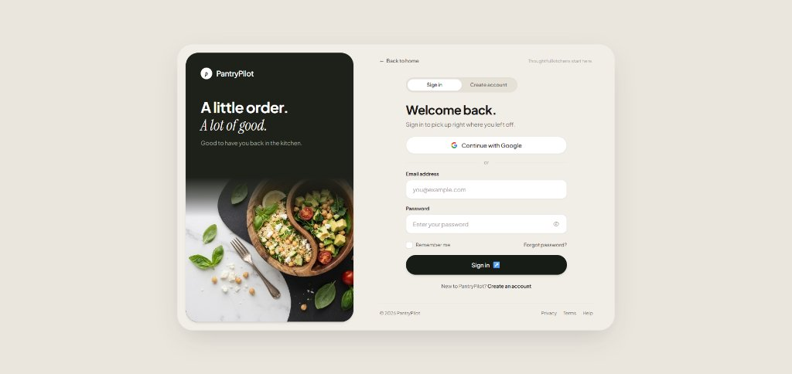
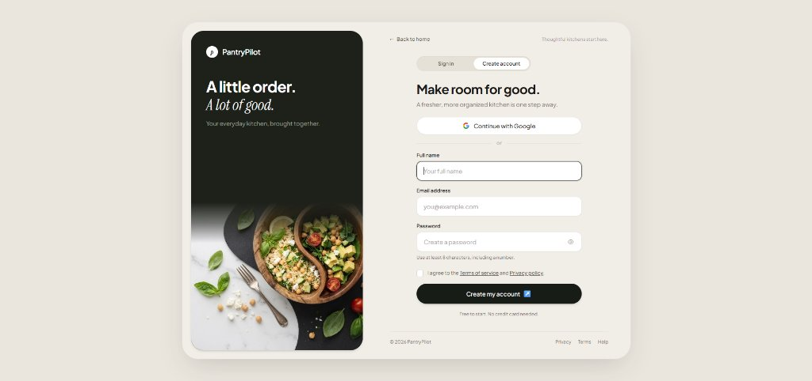

# PantryPilot

A modern kitchen and grocery management platform built with **Laravel**, **React (TypeScript)**, **Tailwind CSS**, and **PostgreSQL**.

---

## Screenshots

| Sign In | Create Account |
|:---:|:---:|
|  |  |

---

## Tech Stack

- **Backend:** Laravel, PHP 8.2+, Eloquent ORM
- **Frontend:** React 18, TypeScript, Inertia.js, Vite
- **Styling:** Tailwind CSS
- **Database:** PostgreSQL
- **Auth:** Laravel Breeze + Laravel Socialite (Google OAuth)

---

## Prerequisites

| Tool | Minimum Version | Download |
| :--- | :--- | :--- |
| **PHP** | `>= 8.2` with `pdo_pgsql`, `openssl`, `mbstring`, `curl` | [php.net](https://www.php.net/downloads) or [Laragon](https://laragon.org/) |
| **Composer** | `>= 2.0` | [getcomposer.org](https://getcomposer.org/download/) |
| **Node.js & npm** | Node `>= 18`, npm `>= 9` | [nodejs.org](https://nodejs.org/) |
| **PostgreSQL** | `>= 14` | [postgresql.org](https://www.postgresql.org/download/) |
| **Git** | Any modern version | [git-scm.com](https://git-scm.com/) |

> **Windows / Laragon users:** Make sure `extension=pdo_pgsql` and `extension=pgsql` are uncommented in your active `php.ini`.

---

## Quickstart

### 1. Clone
```bash
git clone https://github.com/Tawfiq-Aziz/Pantry_Pilot.git
cd Pantry_Pilot
```

### 2. Install dependencies
```bash
composer install
npm install
```

### 3. Environment setup
```bash
cp .env.example .env
php artisan key:generate
```

### 4. Create the database
```sql
-- In psql or pgAdmin
CREATE DATABASE pantry_pilot;
```

Then fill in your credentials in `.env`:
```env
DB_CONNECTION=pgsql
DB_HOST=127.0.0.1
DB_PORT=5432
DB_DATABASE=pantry_pilot
DB_USERNAME=postgres
DB_PASSWORD=your_password
```

### 5. Run migrations
```bash
php artisan migrate
```

### 6. (Optional) Google OAuth

To enable "Continue with Google":

1. Go to [Google Cloud Console](https://console.cloud.google.com) → APIs & Services → Credentials
2. Create an **OAuth 2.0 Client ID** (Web application)
3. Add `http://localhost:8000/auth/google/callback` as an authorised redirect URI
4. Copy the credentials into `.env`:

```env
GOOGLE_CLIENT_ID=your-client-id.apps.googleusercontent.com
GOOGLE_CLIENT_SECRET=your-client-secret
GOOGLE_REDIRECT_URI=http://localhost:8000/auth/google/callback
```

5. Clear config cache:
```bash
php artisan config:clear
```

> Without these keys the Google button still works — it redirects back to the login page with an info message instead of crashing.

### 7. Start the dev servers

**Terminal 1 — backend:**
```bash
php artisan serve
```

**Terminal 2 — frontend (HMR):**
```bash
npm run dev
```

Open [http://localhost:8000](http://localhost:8000) — it lands directly on the login page.

---

## Available Commands

| Command | Description |
| :--- | :--- |
| `npm run dev` | Vite dev server with hot-module replacement |
| `npm run build` | Production build (TypeScript + CSS) |
| `php artisan serve` | Laravel dev server on `localhost:8000` |
| `php artisan migrate` | Run pending database migrations |
| `php artisan migrate:fresh` | Wipe and re-run all migrations |
| `php artisan test` | Run PHPUnit test suite |
| `php artisan route:list` | List all registered routes |
